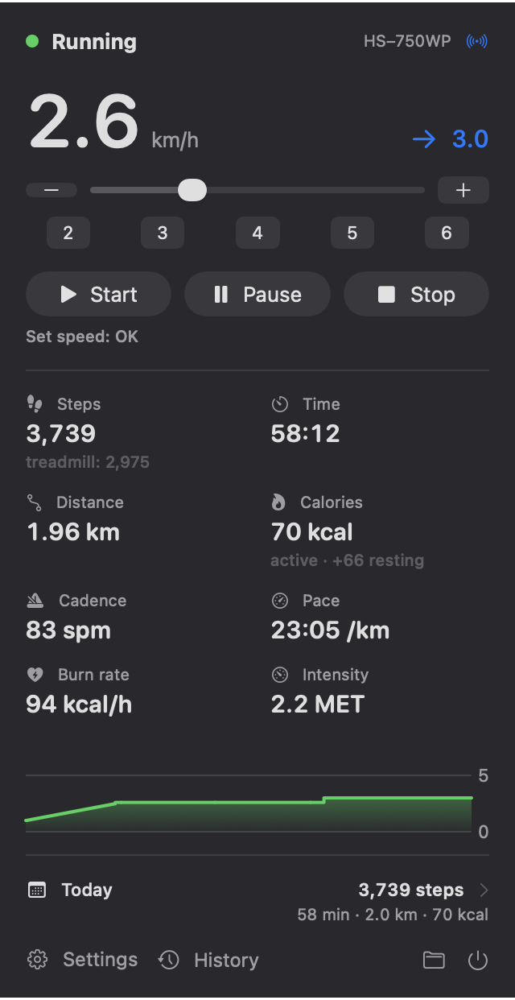
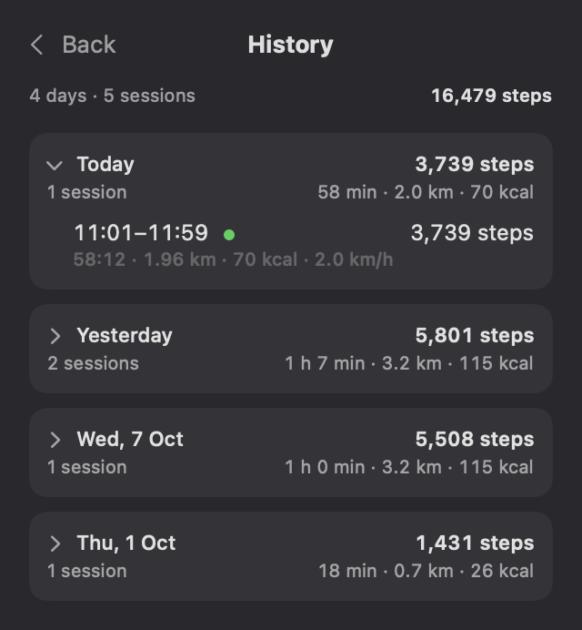
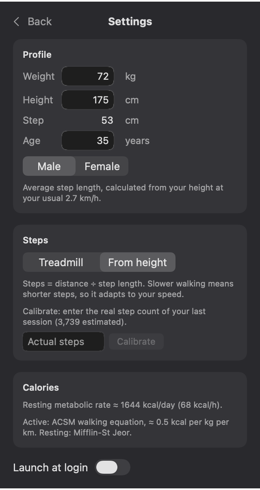

# TreadmillBar

A macOS menu bar app for monitoring and controlling FitShow-based walking pads over Bluetooth LE.

The treadmill's own remote shows little and remembers nothing. TreadmillBar shows live speed, steps, distance, calories and cadence in the menu bar, lets you change speed and start/stop the belt from the Mac, and keeps a history of every workout.

<p>
  
  
  
</p>

## Features

- **Live readout.** Steps and elapsed time in the menu bar. The panel shows speed, distance, calories, cadence, pace, burn rate and intensity (MET), with a 10-minute speed chart.
- **Belt control.** Start, pause and stop, speed presets, a slider and ±0.1 km/h nudges. Fast slider drags are coalesced so only the last value is sent.
- **Workout history.** Every session is recorded and grouped by day, with totals per day and for all time. The current session is saved continuously and picked up again after an app restart, so nothing is lost if the app quits mid-walk.
- **Step estimation.** The built-in step counter on these devices is unreliable. Steps can instead be estimated from distance and a speed-dependent step length based on your height, and calibrated against a real step count.
- **Calorie estimation.** Active energy uses the ACSM walking equation, resting energy uses Mifflin-St Jeor. Without a profile, the treadmill's own value is shown.
- **Launch at login**, via `SMAppService`.

## Requirements

- macOS 14 Sonoma or later
- Swift 5.10 toolchain (Xcode 15.3+ or the Command Line Tools)
- A treadmill that exposes the FitShow service (`0xFFF0`) together with FTMS (`0x1826`). Developed and tested on an HS-750WP walking pad. Devices advertising a name starting with `HS` are also picked up.

## Build and install

```sh
./build.sh            # builds build/TreadmillBar.app
./build.sh install    # also copies it to ~/Applications and launches it
```

The app is ad-hoc signed. macOS asks for Bluetooth permission on first launch.

Set `TREADMILLBAR_DEBUG=1` to log raw samples and status messages to stdout.

To render the panel with sample data without a treadmill (useful for checking layout changes):

```sh
.build/release/TreadmillBar --snapshot panel.png
.build/release/TreadmillBar --snapshot history.png --history
.build/release/TreadmillBar --snapshot settings.png --settings
```

## How it works

### Protocol

The device speaks two protocols at once, and the app uses both:

| Purpose  | Service             | Characteristic                                      |
|----------|---------------------|-----------------------------------------------------|
| Readings | FitShow `FFF0`      | write `FFF2` (status query), notify `FFF1` (status) |
| Control  | FTMS `1826`         | Control Point `2AD9`, Supported Speed Range `2AD4`  |

The status query `02 51 51 03` is sent every 0.5 s. The reply frame is:

```
02 51 ST SP IN TT TT DD DD CC CC SS SS ?? ?? XX 03
```

`ST` status, `SP` speed [0.1 km/h], `IN` incline, `TT` time [s], `DD` distance [m], `CC` calories [0.1 kcal], `SS` steps. Multi-byte fields are little-endian. `XX` is the XOR of all bytes between `02` and `XX`.

Control uses standard FTMS opcodes: `00` request control, `02 <u16>` set target speed [0.01 km/h], `07` start/resume, `08 01` stop, `08 02` pause. Responses arrive as indications in the form `80 <opcode> <result>`.

If another app on the Mac already holds the connection, the treadmill stops advertising. TreadmillBar then retrieves the connected peripheral instead of scanning.

### Estimates

- **Active energy:** `VO2 = 0.1 · v` (ml/kg/min, `v` in m/min, flat belt) at 5 kcal per litre of O2. This works out to about 0.5 kcal per kg per km regardless of speed, and matches how Apple Health reports active energy.
- **Step length:** `0.415 · height · sqrt(v / 5 km/h)`, clamped to 0.5–7 km/h. Steps are integrated over each distance increment at the current speed, so a workout with changing speeds is counted correctly. A per-user calibration factor corrects the model.

### Data

| What                   | Where                                                          |
|------------------------|----------------------------------------------------------------|
| Sessions               | `~/Library/Application Support/TreadmillBar/sessions.json`     |
| Profile and settings   | `UserDefaults` (`app.treadmillbar`)                            |

`sessions.json` is a plain JSON array with ISO 8601 dates, so it is easy to process with tools like `jq`. The folder button in the panel reveals it in Finder.

## Project layout

```
Sources/TreadmillBar/
  App.swift           entry point, MenuBarExtra scene, snapshot renderer
  Treadmill.swift     CoreBluetooth central: discovery, polling, control, live state
  Protocol.swift      GATT UUIDs, FitShow frame parser, FTMS commands, formatting
  SessionStore.swift  workout recording, resume after restart, persistence
  Profile.swift       user profile and step source, stored in UserDefaults
  Energy.swift        ACSM energy and gait (step length) models
  PanelView.swift     SwiftUI panel: main, history and settings pages
```

## License

[MIT](LICENSE)
